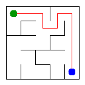

# Assignment 3. Maze Escape

Student ID: 254826
Name: Akylbek Madiyar
Group: SE-2532
Maze size (rows x columns): 10 x 8 (142 inner walls, 192 slides)

This file is the report. How to start: `START_HERE.md`. The task: `docs/Assignment3.pdf`.

## Program output

The 13 lines my program prints on my data (`java -cp out Main`):

    Broken: 79
    Kept: 63
    Last broken wall: 112
    MST cost: 23395
    Heaviest broken wall: 822
    Path length: 18
    DFS visited: 38
    Dead ends: 27
    Zones: 80
    Largest zone: 1
    Is DAG: 1
    Flow stages: 14
    Fastest route cost: 20

My maze:

## Questions

**Mission 0. What do find and union do, and what makes them fast in your code?**

`find(x)` returns the root of the group that contains x. `union(a, b)` joins the groups of a and b and returns `true`
if they were different groups, or `false` if the cells were already together. Two things make it fast. Union by size
puts the smaller tree under the larger one, so the trees stay low. Path compression in `find` hangs every cell on the
way up directly under the root, so the next `find` on those cells is almost one step. Together one operation costs
almost O(1) (formally O(alpha(n))).

**Mission 1. Why is Broken always R*C - 1, and Kept always (R-1)*(C-1)?**

At the start there are R*C groups (every cell alone). A wall is broken only when `union` joins two different groups, so
every broken wall lowers the number of groups by exactly 1. The walls in the file connect all cells, so at the end there
is 1 group. From R*C groups to 1 group we need exactly R*C - 1 breaks. The number of inner walls is
R*(C-1) + C*(R-1) = 2RC - R - C, so the walls that stay are (2RC - R - C) - (RC - 1) = RC - R - C + 1 = (R-1)(C-1).
For my maze: 10*8 - 1 = 79 broken, 9*7 = 63 kept, and 79 + 63 = 142 walls.

**Mission 2. My MST cost from Kruskal and from Prim, and why they are equal:**

Both give 23395 (heaviest broken wall 822). Kruskal takes the walls from the cheapest to the most expensive and breaks
a wall if it joins two groups. Prim grows one tree from cell 0 and always breaks the cheapest wall that leaves the tree.
Both rely on the same rule: the cheapest wall that connects two different parts is always safe to take. All costs are
different, so the cheapest maze is unique, and both algorithms must build exactly it.

**Mission 3. Why is there exactly one path between two cells? How did you avoid a stack overflow on a huge maze?**

A wall is broken only if its two cells were not connected yet, so breaking walls never makes a loop. The maze is
connected and has no cycle, so it is a tree, and in a tree there is exactly one simple path between two cells.
My DFS does not use recursion. It keeps its own stack in an array, and for every cell it remembers which of the four
directions (up, right, down, left) it tries next. So the depth of the search does not use the Java call stack, and
a 1000 x 1000 maze should not overflow the stack.

**Mission 4. Why does the second pass of Kosaraju go on the reversed graph? Why do the slides have no cycle exactly when Zones equals the number of cells?**

The first pass gives the cells in the order they are finished. The last finished cell is in a zone that no other zone
can slide into (a source zone). In the second pass, if we went on the normal slides, the DFS would leave this zone and
reach later zones too, and they would be mixed into one. On the reversed slides it can only reach cells that can slide
into it, and those are exactly the cells of its own zone (earlier zones are already taken). So every DFS of the second
pass collects exactly one zone, and the zones come out in a topological order.
If there is a cycle, the cells of the cycle can reach each other, so they are in one zone and Zones is less than the
number of cells. If there is no cycle, no two cells can reach each other, so every cell is its own zone and
Zones = number of cells. (There are no slides from a cell to itself, so a zone of one cell is not a cycle.)

**Mission 5. Why is it enough to go through the zones in the order of their numbers? What does this pass cost?**

The zone numbers are a topological order: every slide between two zones goes from a smaller number to a larger one.
So when I reach a zone, all zones that can lead into it have already been processed and its value (longest chain,
cheapest cost) cannot change any more. Every slide is used once, and no priority queue is needed.
The cost is O(n + S): n for the zones and cells, S for looking at every slide once.

## AI use

I used Claude (Anthropic) as a helper during the whole assignment. I used it to explain the assignment and the algorithms (DSU, Kruskal, Prim, iterative DFS, Kosaraju, topological order of zones), to write the first versions of the code for Missions 0 to 5 and the tests, and to draft the README answers. I ran everything on my own data, checked it with `java tools/Check.java`, and read the code to understand it. I did not use code or text from books or websites.

## Timing (Mission 7)

Milliseconds, 5 runs each, from `java -cp out Bench` (average of 5 runs).

| maze | Kruskal | Prim |
|---|---|---|
| 100 x 100 | 5 | 6 |
| 300 x 300 | 16 | 76 |
| 1000 x 1000 | 353 | 1752 |

Going from 300x300 to 1000x1000 the maze has about 11 times more cells and walls, and the time grew about 22 times for Kruskal (16 to 353 ms) and about 23 times for Prim (76 to 1752 ms). That is faster than linear and a bit more than the 13 times that O(m log m) predicts, probably because a big maze does not fit in the CPU cache, so memory access gets slower. Prim is about 5 times slower than Kruskal on the biggest maze, probably because the PriorityQueue stores boxed Long objects and does many heap operations, while Kruskal sorts a plain long[] array. The 100x100 numbers are too small to be reliable: for Kruskal the first run took 16 ms and the next ones only 2 to 4 ms, because Java needs time to warm up (JIT), so I use the average of 5 runs.

## Complexity

n is the number of cells, m the number of walls (or slides).

| algorithm | time | space | assumptions |
|---|---|---|---|
| DSU find and union | O(alpha(n)) per operation, almost O(1) | O(n) | union by size and path compression |
| Kruskal | O(m log m) | O(n + m) | sorting the walls costs O(m log m); the m union calls cost almost O(m) |
| Prim | O(m log m) | O(n + m) | binary heap (PriorityQueue); every wall is pushed into the heap at most once per end |
| DFS | O(n + m) | O(n) | explicit stack; in the maze m = n - 1 open doors |
| Kosaraju | O(n + S) | O(n + S) | two DFS passes, lists of slides and of reversed slides |
| Route in the zone graph | O(n + S) | O(n + S) | zones in topological order, every slide looked at once, no priority queue |

## Before you submit

- data/walls.txt, data/slides.txt and output/maze.png are in the repository.
- `java tools/Check.java` shows all examples right.
- This README is filled in, the program output and the section AI use included.
- The work is pushed to main (at least one commit per mission) and the repository is public.
- The link is attached in Moodle.